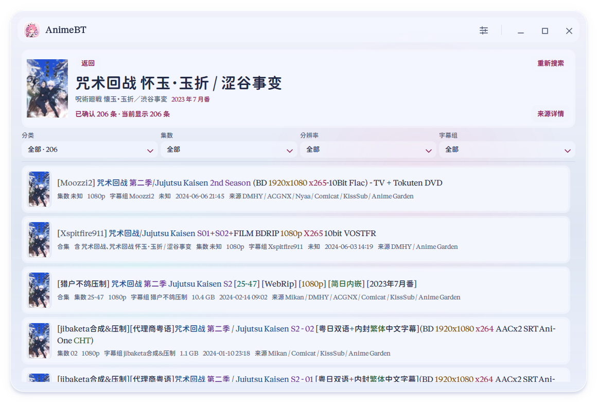

  

<h1 align="center">AnimeBT</h1>

输入番名，点开海报，找到想看的那一季。

  <a href="https://github.com/Akalin10/AnimeBT/releases/download/v1.1.0/AnimeBT-1.1.0-Windows-x64.zip"><strong>下载 Windows x64 版</strong></a>
  · <a href="https://github.com/Akalin10/AnimeBT/releases">发布记录</a>
  · <a href="docs/guide.md">使用指南</a>

## 三步开始

1. 下载 ZIP，解压整个文件夹，双击 `AnimeBT.exe`。无需安装 Python。
2. 输入番名，例如 `Re:Zero`，按 Enter。找到资源的作品会陆续显示海报。
3. 点开海报，按集数、清晰度或字幕组挑选。点击缩略图可复制磁链，右键可保存 Torrent。

## 找番更省事

- **一次查 11 个来源** · 支持用中文、日文和英文片名找资源，列表上能看到每条资源来自哪里。
- **按作品找资源** · 不同季度、OVA 和剧场版分开显示，避免把同系列的其他作品混在一起。
- **界面随你调** · 浅色、深色和四档海报尺寸都在右上角设置，启动动画也可关闭。

查看更多界面截图

| 浅色首页 | 深色首页 |
| --- | --- |
|  |  |

## 源码与终端版

项目也提供终端界面。安装方式、快捷键、来源设置和 Windows 打包步骤都整理在使用指南里。

[使用与构建指南](docs/guide.md) · [来源覆盖与测试](docs/search-audit.md) · [更新记录](CHANGELOG.md)

仅用于有权获取的资源，请遵守来源站点规则。
