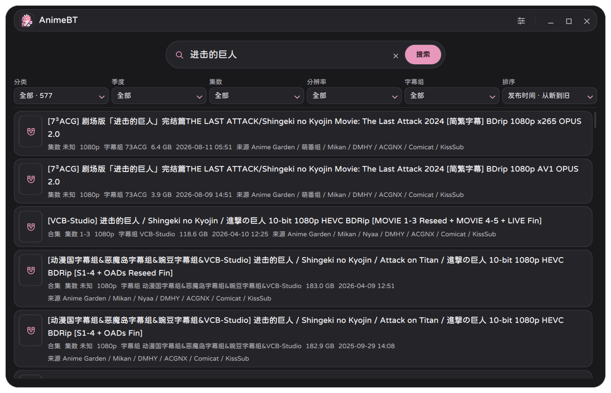
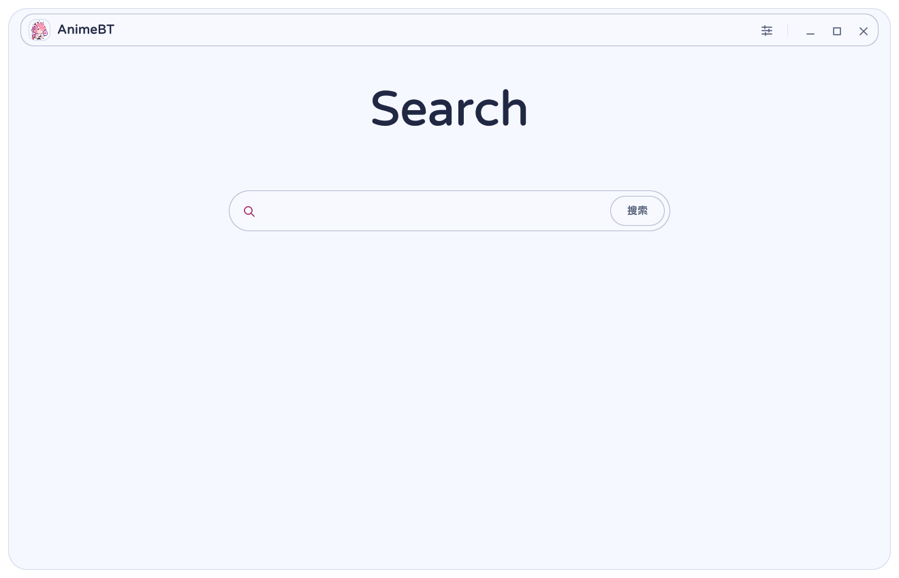

<div align="center">
  
  <h1>AnimeBT</h1>
  <p>Windows 动画 BT 资源检索工具，使用 PySide6 + QML 构建。</p>
  <p><a href="https://github.com/Akalin10/AnimeBT/releases/download/v1.0.0/AnimeBT-1.0.0-Windows-x64.zip">下载 Windows x64 版</a> · <a href="https://github.com/Akalin10/AnimeBT/releases">Releases</a> · <a href="docs/guide.md">使用指南</a></p>
</div>

## 功能

- **列表检索**：直接搜索 BT 来源，不依赖 Bangumi；支持增量加载、筛选和排序。
- **图鉴检索**：通过 Bangumi 获取作品信息和海报；服务不可用时尝试 AniList。资源经过作品归属核验后展示。
- 按分类、季度、集数、分辨率和字幕组筛选；支持复制磁链、复制原标题和保存 Torrent。
- 可选 OpenAI 兼容 API 整理资源标题；结构化结果通过本地证据校验后仅用于显示。
- 普通浅色／深色主题，以及应用内 Liquid Glass 深色主题；支持自定义本地壁纸、亮度和 Clear ↔ Tinted 背景模糊调节。
- 窗口内启动动画与可选择不再显示的启动提示。

本版本仅提供 GUI，不包含 TUI、BT 下载器或播放器。

## 界面预览

### 列表检索



### 图鉴检索


<details>
<summary>首页、玻璃主题与启动画面</summary>

| 普通深色 | 普通浅色 |
| --- | --- |
|  |  |


</details>

截图使用应用默认背景，不包含个人自定义壁纸；封面由作品信息服务返回，不随程序打包。

## 资源来源

Anime Garden、Mikan（蜜柑计划）、ACG.RIP、萌番组、DMHY（动漫花园）、ACGNX、KissSub（爱恋动漫）、Comicat（漫猫动漫 BT）、Nyaa、Tokyo Toshokan 和 MioBT，共 11 个来源。

各站可访问性与返回范围不同；MioBT 使用近期订阅条目，不能视作完整历史索引。列表检索的关键词命中不等于确认作品归属，图鉴检索则保留严格核验。季度证据不足时显示“未知”，不猜测季数。

## 使用

下载 ZIP 后完整解压，运行目录内的 `AnimeBT.exe`，不要单独移动 EXE。无需安装 Python，支持 Windows 10／11 x64。未签名程序可能触发 Windows 下载或运行提示。

在设置中选择检索模式。输入关键词后按 Enter；资源行左侧磁铁按钮复制磁链，右键菜单提供其他操作。「来源详情」和「深入搜索」位于列表模式搜索框的右键菜单中。

图鉴与各来源的网络可访问性因环境而异；列表模式不请求 Bangumi。AI 功能默认关闭，需自行配置 API。程序不提供代理或下载服务。

## 源码运行与构建

需要 Windows x64 和 Python 3.11 或以上版本：

```powershell
python -m pip install ".[gui]"
python -m animebt.gui
```

构建 Windows 发布包：

```powershell
powershell -ExecutionPolicy Bypass -File tools/build.ps1 -Python python
```

构建脚本将生成 `dist/AnimeBT-1.0.0-Windows-x64.zip`。QML 和预编译 Shader 随程序打包，详细说明见[使用指南](docs/guide.md)。

程序优先使用系统已安装的猫啃网糖圆体；字体缺失时自动回退，不附带或安装字体。用户配置、密钥、壁纸和缓存不会随源码或发布包分发。

## 说明

仅检索和获取有权访问的资源，并遵守来源站点规则与适用法律。第三方组件许可见 [THIRD_PARTY.md](packaging/THIRD_PARTY.md)。仓库尚未指定项目自身的开源许可证。
