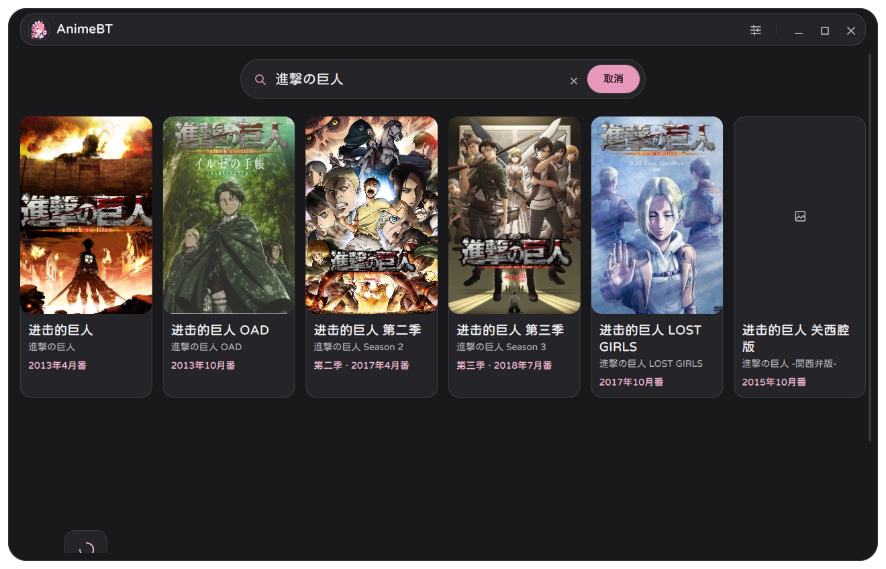
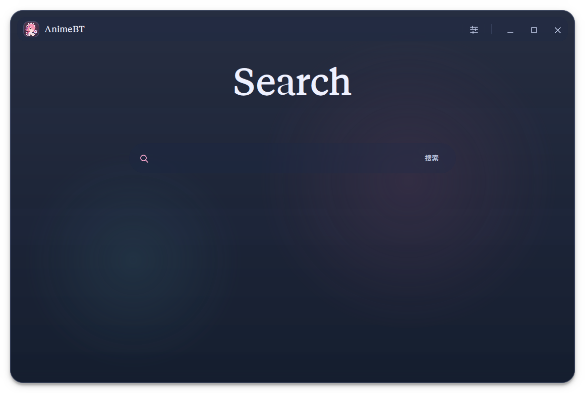
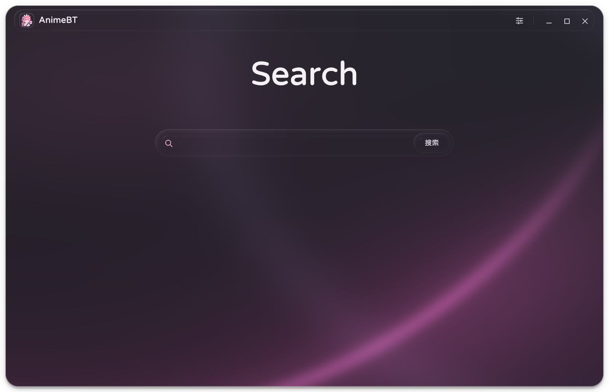

<div align="center">
  
  <h1>AnimeBT</h1>
  <p><a href="https://github.com/Akalin10/AnimeBT/releases/download/v1.0.0/AnimeBT-1.0.0-Windows-x64.zip">下载 Windows x64 版</a> · <a href="https://github.com/Akalin10/AnimeBT/releases">Releases</a> · <a href="docs/guide.md">使用指南</a></p>
</div>

## 功能

## 功能

- 🔎 **列表检索**：直接搜索 BT 来源，无需 Bangumi 参与，支持增量加载，还能按条件筛选和排序。

- 🖼️ **图鉴检索**：通过 Bangumi 获取作品信息和海报，Bangumi 不可用时自动切换到 AniList。展示前会核验资源是否属于对应作品。

- 🧩 **筛选与导出**：可按分类、季度、集数、分辨率和字幕组筛选，支持复制磁链、复制原标题，也能保存 Torrent 文件。

- 🤖 **AI 整理（可选）**：可接入 OpenAI 兼容 API 整理资源标题，AI 结果需先通过本地证据校验才会显示。

- 🎨 **外观**：提供浅色和深色主题，另有应用内的 Liquid Glass，可自定义本地壁纸，并调节亮度与背景模糊程度。

## 界面预览

### 列表检索


### 图鉴检索



<details>
<summary>首页、玻璃主题与启动画面</summary>

| 普通深色 | 普通浅色 |
| --- | --- |
|  |  |




</details>

## 资源来源

Anime Garden、Mikan（蜜柑计划）、ACG.RIP、萌番组、DMHY（动漫花园）、ACGNX、KissSub（爱恋动漫）、Comicat（漫猫动漫 BT）、Nyaa、Tokyo Toshokan 和 MioBT，共 11 个来源。

有些来源可能由于网络影响而不稳定，但是不影响正常使用

## 使用

📦 安装
  下载 ZIP 后完整解压，运行 AnimeBT.exe 即可
⚙️ 检索
  🧲 点击资源左侧的磁铁按钮复制磁链
  🖱️ 右键资源可查看更多操作
⚠️ 注意
  📁 请保持解压后的文件夹完整，不要单独移动 EXE
  🔐 程序未签名，Windows 可能弹出下载或运行提示，确认来源后继续即可
  🌐 图鉴与各来源的连通性取决于网络环境，列表模式不请求 Bangumi
  🤖 AI 功能默认关闭，需在设置中配置自己的 API
  🚫 程序不提供代理或下载服务

## 源码运行与构建

需要 Windows x64 和 Python 3.11 或以上版本：

```powershell
python -m pip install ".[gui]"
python -m animebt.gui
```

构建 Windows 发布包：

```powershell
powershell -ExecutionPolicy Bypass -File tools/build.ps1 -Python python
```

构建脚本将生成 `dist/AnimeBT-1.0.0-Windows-x64.zip`。QML 和预编译 Shader 随程序打包，详细说明见[使用指南](docs/guide.md)。
