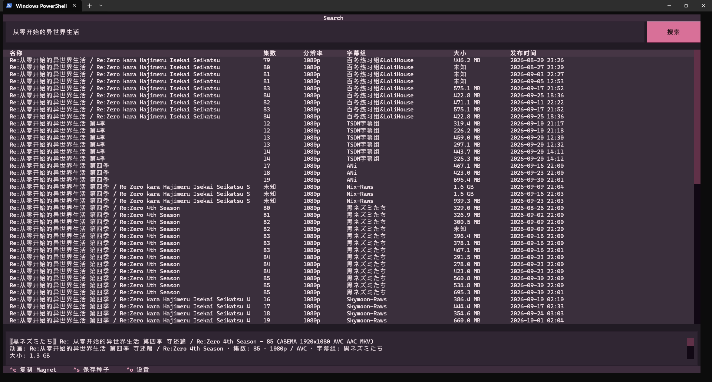

# AnimeBT 使用与构建指南

[返回项目首页](../README.md)

## TUI



终端版使用原有八个 BT 来源。使用 Python 3.11 或更新版本，在源码目录运行：

```powershell
python -m pip install .
python -m animebt
```

- 点击表头排序。
- Ctrl+C 复制磁链；Ctrl+S 保存种子。
- Ctrl+O 设置目录和主题；Ctrl+R 刷新；Ctrl+Q 退出。
- 配置、缓存、日志自动创建于 `%LOCALAPPDATA%/AnimeBT`。

## 从源码运行 Windows GUI

在项目根目录运行：

```powershell
python -m pip install ".[gui]"
python -m animebt.gui
```

安装后也可用 `animebt-gui` 启动。拖动顶部空白区域移动窗口，拖动边缘或角落调整大小。
浅色和深色主题各自使用默认玻璃材质。所有玻璃表面共享着色、模糊和折射参数，阅读区域会自动保持对比度。
折射取样于 AnimeBT 窗口内的实时 QML 画面。页面共用环境纹理，弹窗按需采样其下方页面，
AI 设置内的编辑菜单还会采样下方对话框。设置中可单独关闭全窗口启动动画，也可关闭全部界面动画。
软件渲染会自动使用简化材质并关闭实时折射。

修改 `animebt/gui/qml/shaders` 中的 GLSL 后，用 Qt Shader Tools 的
`qsb --qsbversion 64 --qt6 -o <源码文件>.qsb <源码文件>` 更新相应的预编译文件。

输入动画名称（例如 `Re:Zero`），按 Enter 或点击「搜索」。GUI 从 Bangumi 读取动画条目，
优先保留原词搜索结果，最多读取两页。原词唯一完整命中一个条目时，可用其原名和登记的别名并发补搜最多三次。
补搜只追加与原词完整匹配或有 Bangumi 直接作品关系的动画，最多追加八条，按 Bangumi ID 去重。
相同关键词的成功结果在本次运行中缓存五分钟。搜索期间可点击「取消」或按 Esc。
后台按作品核验资源，仅在找到带磁链或种子入口且归属明确的条目时显示海报。可在核验期间打开已确认的作品。
封面由 Qt 异步加载并写入用户缓存。右上角设置中可选择四档海报尺寸。顶部窗口控制按钮固定，搜索区域随海报滚动。

点击海报打开资源详情。GUI 在原有八源之外也查询 Nyaa、Tokyo Toshokan 和 MioBT 的公开索引。
MioBT 在近期订阅条目中按关键词筛选，覆盖范围取决于订阅当前返回的条目。
扩展来源只接收生肉分类和标题明确标记中文的动画资源。详情页显示每个来源的确认数和失败原因。
来源返回 HTTP 429 时会按其 `Retry-After` 暂停后续请求。
支持按集数、分辨率和字幕组组合筛选，资源标题按来源原样显示。点击「返回」或按
Esc 可回到同一批搜索结果。

GUI 独立查询作品的多语言别名，并用 Bangumi 关联关系补查系列名称。点「重新搜索」可用更高预算查找更多历史页面。各来源的覆盖边界见 [检索审计](search-audit.md)。
资源可按「独立资源」「合集资源」筛选。只有能确认属于所选 Bangumi 作品的资源才会展示和计数。
明确包含多个条目的合集会在相应作品页显示，证据不足的候选直接排除。

可在 `%LOCALAPPDATA%/AnimeBT/bt-sources.json` 分别启停扩展来源、配置每次检索的超时，
重启 GUI 生效。省略配置时三个扩展来源均启用，每次检索超时 9 秒。以下示例关闭 Tokyo Toshokan。

```json
{
  "Nyaa": {"enabled": true, "timeout": 9},
  "Tokyo Toshokan": {"enabled": false, "timeout": 9},
  "MioBT": {"enabled": true, "timeout": 9}
}
```

左键点击资源行的缩略图可复制磁链。已有磁链时会直接复制，只有种子链接时会在后台解析。
右键点击资源行，可复制原始标题、复制磁链或将 Torrent 文件保存到所选位置。

资源原始标题默认按语法着色。可在「AI 智能整理」填写 OpenAI 兼容的 Base URL、
模型与 API Key，点击「测试连接」后保存。默认使用本地规则与 Bangumi 片名。启用 AI 后，
仅将进入视口的疑难标题及本地已识别片段发给所选服务。AI 补充的片段需经本地校验，
且仅用于标题展示。API Key 由 Windows DPAPI 加密保存。HTTP 仅允许连接本机服务。

Bangumi 的公开搜索可以直接使用。如需认证，在启动进程的环境中设置 `ANIMEBT_BANGUMI_TOKEN`。
GUI 仅向 Bangumi 搜索接口发送该凭据。

## 构建与测试

在 Windows x64 上安装 64 位 Python，在项目目录执行：

```powershell
python -m pip install ".[gui]"
python -m unittest discover -s tests -q
powershell -ExecutionPolicy Bypass -File tools/build.ps1 -Python python
```

构建脚本使用锁定的依赖版本，生成 `dist/AnimeBT/`、Windows ZIP 及 ZIP 的 SHA-256 校验文件。第三方许可和对应源码见 [第三方组件声明](../packaging/THIRD_PARTY.md)。项目自身尚未指定开源许可证。

仅用于有权获取的资源，请遵守版权法律和来源站点规则。
